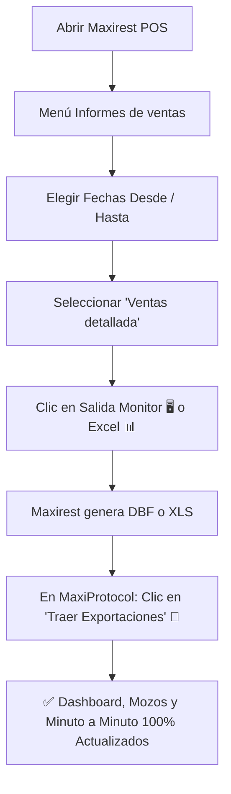

# 📋 GUÍA MAESTRA DE INFORMES Y EXPORTACIONES DE MAXIREST POS
## Manual Operativo de Extracción y Fidelidad de Datos para MaxiProtocol

> **Cliente Gastronómico:** #10783 — *Gastro Market SRL / Gardenias Restó*  
> **Sistema Fuente:** Maxirest POS (v7.1 / Delphi Nativo)  
> **Regla de Oro:** **Cero Simulación / Fidelidad Fiscal 1:1**

---

## 🎯 1. Diagnóstico del Mensaje: ¿Qué informe debes exportar?

### ⚠️ El Mensaje en Pantalla:
> *"Este colaborador cuenta con arqueo fiscal oficial consolidado de Maxirest POS, pero no se emitió el archivo temporal de comanda granular en pantalla para este día. Para preservar la fidelidad fiscal 1:1 y la regla de Cero Simulación, no se extrapolan minutos ficticios."*

### 💡 ¿Por qué aparece este mensaje?
1. **MaxiProtocol ya tiene los totales oficiales del mozo:** Sabe exactamente que para el 25/10/2026, Rocío facturó **$1.346.770** en **22 comprobantes**, atendió **60 comensales (cubiertos)** y su turno fue de **12:40 a 20:15**. Estos datos provienen del arqueo general o de *Ventas por empleado*.
2. **Lo que falta es el archivo de comandas minuto a minuto:** Para mostrar la **Línea de Tiempo Cronológica** (a qué hora exacta se pidió cada café, qué mesa atendió a las 14:15, qué postre marchó a las 16:30), Maxirest POS requiere que se emita el informe detallado comanda por comanda.
3. **Por la Regla de Cero Simulación:** MaxiProtocol **se niega a inventar horarios falsos o minutos aleatorios**. Por eso muestra el balance verídico y te indica que falta la comanda granular.

---

### 🚀 Solución Inmediata (Paso a Paso en Maxirest POS):

Para que aparezca la cronología minuto a minuto de las ventas de ese día:

1. En la ventana **"Informes de ventas"** de Maxirest POS (tu primera captura de pantalla):
   - **Fecha Desde / Hasta:** Coloca la fecha deseada (ej. `25/10/2026` a `25/10/2026` o el rango).
   - **Pto. Venta:** `1` (o Todos).
   - **Turno:** `Todos`.
2. En el recuadro **"Informe"**, selecciona:
   👉 **`Ventas detallada`** *(el que tienes seleccionado en azul en la foto)*  
   o también 👉 **`Ventas por mozo detalladas`**.
3. En la sección inferior **"Salida por"**, pulsa uno de estos dos botones:
   - 🖥️ **Botón Monitor (Pantalla Azul):** Abre el informe en pantalla. Al abrirse, Maxirest crea automáticamente en milisegundos un archivo `.dbf` en `C:\MaxiRest` con la comanda granular (longitud de registro de 305 bytes con fecha, hora, mozo, mesa y artículo).
   - 📊 **Botón Excel (Icono verde de planilla):** Exporta el informe a `.xls` en tu Escritorio o Descargas.
4. Vuelve al panel de MaxiProtocol y pulsa **`[🔄 Traer Exportaciones]`** o **`[⚡ Sincronizar POS]`** (o espera 3 segundos al auto-sincronizador).
5. ¡Listo! Al volver a abrir el modal del mozo, el aviso de auditoría desaparece y se despliega la **Línea de Tiempo Completa con cada venta, hora, mesa y plato**.

---

## 📚 2. Catálogo Completo: ¿Qué informe de Maxirest alimenta cada módulo de MaxiProtocol?

La ventana **Informes de ventas** de Maxirest POS contiene diversos reportes. A continuación se detalla qué genera cada uno y qué sección desbloquea en MaxiProtocol:

| # | Nombre del Informe en Maxirest POS | Datos que Contiene | Módulo que Desbloquea en MaxiProtocol | Archivo Interno Generado |
| :---: | :--- | :--- | :--- | :--- |
| **1** | **`Ventas detallada`** ⭐ *(Recomendado)* | Fecha, hora exacta, mozo, mesa, nro ticket, rubro, código artículo, plato, cantidad, precio e importe. | **Modo Historial minuto a minuto** en el modal de mozos, curvas horarias reales por artículo y comanda granular. | `C:\MaxiRest\*.dbf` (305 bytes/reg) o `Desktop\*.xls` |
| **2** | **`Ventas por mozo detalladas`** ⭐ | Ventas desglosadas por cada mozo con detalle de comprobante, mesa, hora y artículos vendidos. | **Auditoría de personal, comensales por mozo, plato estrella y postres vendidos** por mozo. | `C:\MaxiRest\*.dbf` o `Desktop\*.xls` |
| **3** | **`Ventas por empleado`** | Totales consolidados por mozo: código, nombre, total facturado, cantidad de tickets y comensales. | **Ranking de Mozos del Dashboard**, facturación por colaborador y ticket promedio por personal. | `C:\MaxiRest\*.dbf` (Campos `COD_EMP`, `NOM_EMP`, `TOTAL`, `VENTAS`) |
| **4** | **`Ventas por formas de cobro`** | Desglose por medio de pago: WNAVE, EFECTIVO, HPEDIDOYA, MERCADO PAGO, tarjetas, tickets y porcentajes. | **Tarjetas de Medios de Pago**, liquidación neta NAVE (94,81%), aranceles e impuestos retenidos. | `C:\MaxiREST_SQL\bakinforme.dbf` o `C:\MaxiRest\*.dbf` |
| **5** | **`Ventas por día (por concepto)`** | Totales clasificados por canal: Salón, Mostrador / Take Away, Domicilio / Delivery, Cubiertos (CUB) y Ventas. | **Canales de Venta (Salón / Mostrador / Envíos)**, comensales CUB exactos y promedios por cubierto. | `C:\MaxiRest\*.dbf` (Campos `CUB`, `SALON`, `MOSTRADOR`, `DOMICILIO`) |
| **6** | **`Ventas resumidas`** | Resumen ejecutivo de facturación, comprobantes y totales por período. | **Balance general diario** y cálculo de variación porcentual contra períodos anteriores. | `bakinforme.dbf` |
| **7** | **`Ventas por artículo / ranking`** | Listado de todos los artículos de la carta ordenados por volumen vendido o por facturación total. | **Ingeniería de Menú (Estrellas, Caballos, Rompecabezas, Perros)** y tabla de platos más vendidos. | `C:\MaxiRest\*.dbf` (Campos `COD_ART`, `NOM_ART`, `CANT`, `IMPORTE`) |
| **8** | **`Ventas horarias`** / **`Ventas por día / hora`** | Facturación agrupada hora por hora (H_1 a H_24) desde las 08:00 hasta las 24:00. | **Gráfico de Curvas Horarias Oficiales**, picos de salón almuerzo/merienda/cena. | `C:\MaxiRest\*.dbf` (Campos `H_1`..`H_24`) |
| **9** | **`Subdiario IVA ventas`** | Listado fiscal con letra de factura (A, B, C), punto de venta, número fiscal, CUIT de clientes y total. | **Auditoría fiscal y fiscalización 1:1**, trazabilidad contable. | Formato DBF fiscal |
| **10** | **`Ventas por insumo`** | Descuento de materias primas y recetas asociadas a los platos vendidos. | Control de stock y costos de mercadería vendida. | Reporte interno |

---

## 🖲️ 3. Las Opciones de "Salida por" en Maxirest POS

En la parte inferior de la ventana hay varios botones que determinan cómo Maxirest emite la información:

```
[🖥️ Pantalla]   [🖨️ Impresora]   [⏸️ Pausa]   [📄 PDF]   [📊 Excel .xls]   [✉️ Email]
```

### 1. 🖥️ Salida por Monitor (Pantalla Azul) — *La más rápida para MaxiProtocol*
- **Cómo opera:** Abre una ventana de previsualización en pantalla dentro de Maxirest.
- **Efecto técnico:** En el momento exacto en que Maxirest genera la vista previa, **vuelca un archivo temporal con extensión `.dbf` en `C:\MaxiRest`**.
- **Ventaja:** No tienes que elegir dónde guardarlo ni nombrarlo. MaxiProtocol detecta la modificación de `C:\MaxiRest` y lo procesa al instante.

### 2. 📊 Salida por Excel (Icono verde .xls) — *Ideal para rangos y resguardos*
- **Cómo opera:** Abre el diálogo de Windows para guardar un archivo `.xls` de Microsoft Excel.
- **Ruta recomendada:** Guárdalo directamente en el **Escritorio** (`C:\Users\Gardenias\Desktop`) o en **Descargas** (`C:\Users\Gardenias\Downloads`).
- **Ventaja:** MaxiProtocol tiene un auto-importador en segundo plano (`import_desktop_xls.py`) que lee cualquier Excel emitido en el Escritorio o Descargas y lo incorpora automáticamente a la base de datos sin tocar la consola.

### 3. 💾 Cierres de Turno Diarios (Arqueo de Caja)
- Al hacer el cierre de caja regular en Maxirest, el sistema vuelca de forma automática el archivo:
  `C:\MaxiREST_SQL\bakinforme.dbf`
- MaxiProtocol monitorea este archivo cada 3 segundos y actualiza el día de **Ayer** y **Hoy** en tiempo real.

---

## 🔄 4. Flujo de Trabajo Recomendado para Operar Autónomamente

Cuando quieras que MaxiProtocol tenga la información más completa y profunda posible (incluyendo minutos exactos de cada plato):



### Checklist Rápido de 3 Pasos:
1. **En Maxirest POS:** Informes de ventas ➔ Fecha ➔ **"Ventas detallada"** ➔ Clic en **Pantalla (Monitor)**.
2. **En MaxiProtocol:** Clic en el botón **`[🔄 Traer Exportaciones]`** (en la barra superior o en el selector de fechas).
3. **Comprobación:** Abre el modal de cualquier mozo (ej. Rocío o Belén); verás la línea de tiempo completa sin avisos pendientes.

---

## 🛡️ 5. Principios de Integridad y Fidelidad Fiscal

1. **Cero Estimación:** Si un dato no fue emitido en los reportes de Maxirest, el sistema lo informa con transparencia en lugar de rellenar con datos sintéticos.
2. **Convergencia Fiscal:** La suma de las ventas de todos los mozos y canales siempre es matemáticamente idéntica al total facturado oficial de Maxirest POS.
3. **Persistencia Permanente:** Cualquier reporte emitido queda almacenado en el registro de auditoría (`config/mozos_daily_audit.json`), por lo que no se pierde al reiniciar la computadora.
